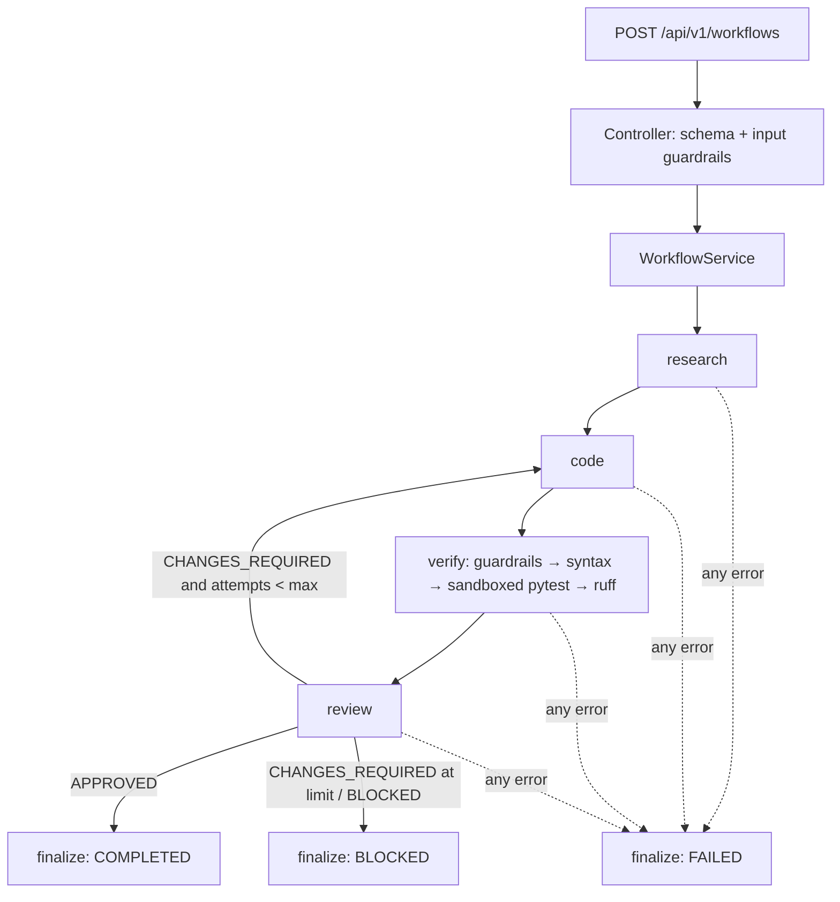

# Multi-Agent AI Coding Workflow

A LangGraph-orchestrated assistant that takes a coding task, **researches** it (optionally through an MCP documentation
server), **generates** code + tests, **verifies** the code by actually running it in a sandbox, has an independent
**reviewer** judge it, and loops through a *bounded* revision cycle before returning a structured result.

## Problem statement
LLM code generation is only useful if it is checked. Most demos trust the model. Here **status is decided by tools, not
by the model**: a reviewer can never approve code whose tests fail, whose syntax is broken, or that violates a guardrail.

## Architecture (layered, SOLID)

```
                HTTP
                 │
┌────────────────▼─────────────────┐  app/controllers   Pydantic request/response validation, input guardrails,
│        CONTROLLER LAYER          │                    output shaping + secret redaction, error envelope. No logic.
└────────────────┬─────────────────┘
┌────────────────▼─────────────────┐  app/services      WorkflowService (run/get/apply), VerificationService,
│          SERVICE LAYER           │                    SandboxRunner, WorkflowEngine port. No HTTP, no SQL.
│  ┌────────────────────────────┐  │
│  │ LangGraph orchestrator     │  │  app/orchestrator  state machine: research→code→verify→review→(loop|finalize)
│  │  agents: Researcher/Coder/ │  │  app/agents        Template-Method agents; talk to LLM via an abstraction
│  │  Reviewer  + guardrails    │  │  app/guardrails    Chain-of-Responsibility input/output guardrails
│  └────────────────────────────┘  │
└───────┬───────────────┬──────────┘
┌───────▼────────┐ ┌────▼─────────┐  app/repositories  SqlAlchemyWorkflowRepository (runs + events),
│ REPOSITORY     │ │ EXTERNAL     │                    FileSystemWorkspaceRepository (path-jailed)
│ LAYER (DB/FS)  │ │ ADAPTERS     │  app/llm, app/tools  Anthropic client (Strategy), Mock client, MCP docs adapter
└────────────────┘ └──────────────┘
         app/container.py = composition root (the only place concrete classes are wired)
```

### Workflow

Workflow statuses: `COMPLETED` (approved) · `BLOCKED` (rejected / iteration limit — never reported as success) · `FAILED` (fatal error).

### Agents
| Agent | Responsibility | Anti-hallucination / safety rule |
|---|---|---|
| Researcher | Plans lookups, calls MCP docs tools, writes structured report | `references` come **only** from tool results; if no docs were consulted it says so in `assumptions` |
| Coder | Reads workspace snapshot, returns complete files + tests; revises from feedback | Output must satisfy schema; unsafe code is rejected before execution |
| Reviewer | Reviews real code with line numbers + **tool facts** | Code forces `CHANGES_REQUIRED` when tests fail/skip, syntax or guardrail errors exist; only tool-derived issues are `verified=true`, LLM opinions are always `verified=false` (suspected vs verified) |
| Orchestrator | LangGraph graph with explicit `WorkflowState` | Bounded loop (`MAX_REVIEW_ITERATIONS`) + hard `recursion_limit` |

### Design patterns used
Strategy (`LLMClient`: Anthropic / Mock) · Factory (`build_llm_client`, `build_agents`, `build_docs_provider`) ·
Template Method (`BaseAgent`) · Repository (`WorkflowRepository`, `Workspace*`) · Chain of Responsibility (`GuardrailChain`) ·
Adapter (`McpDocsProvider`, `LangGraphWorkflowEngine`) · Null Object (`NullDocsProvider`) · Dependency Injection (`container.py`) ·
State Machine (LangGraph).

### SOLID mapping
- **S** – one reason to change per class (e.g. `FileScopeGuard` only checks paths; `SandboxRunner` only executes).
- **O** – add a guardrail/agent/LLM by adding a class; no existing code edited.
- **L** – `MockLLMClient`, `AnthropicLLMClient` and test doubles are interchangeable behind `LLMClient`.
- **I** – `WorkspaceReader` and `WorkspaceWriter` are separate ports (the coder can't write; the service can't read).
- **D** – services/agents depend on abstractions (`LLMClient`, `WorkflowRepository`, `WorkflowEngine`, `DocsProvider`, `CodeRunner`).

### Guardrails
| Stage | Checks |
|---|---|
| Input (controller) | length/schema, control chars, prompt-injection heuristics, secrets in input, destructive/malware intent |
| Prompting | untrusted text wrapped in tags, closing tags neutralised, "treat as data" system note |
| Output (before execution) | path traversal/absolute paths/protected files/file types/size/duplicates · AST scan: banned imports (`subprocess`, `socket`, network libs, `pickle`…) and calls (`eval`, `exec`, `os.system`, file deletion…) · hardcoded secrets |
| Execution | scrubbed env (no API keys), temp dir, CPU/memory/file-size rlimits, hard timeout, project pytest config ignored |
| Response | schema-shaped output, secret redaction, generic 500s (no stack traces) |
| Apply | only if request asks **and** `APPLY_CHANGES_ENABLED=true` **and** reviewer APPROVED; all paths jailed |

## Install & run
```bash
python3 -m venv .venv && . .venv/bin/activate
pip install -r requirements.txt
cp .env.example .env            # set ANTHROPIC_API_KEY, or LLM_PROVIDER=mock for an offline demo
uvicorn app.main:create_app --factory --port 8000
# docs: http://localhost:8000/docs
```
CLI: `python -m app.cli run "Implement ... with tests"` · `python -m app.cli mcp-check`

### Endpoints
| Method | Path | Purpose |
|---|---|---|
| POST | `/api/v1/workflows` | Run a workflow (synchronous; returns the full result) |
| GET | `/api/v1/workflows/{id}` | Status + stored result (persisted in DB) |
| GET | `/api/v1/workflows/{id}/events` | Step-by-step audit trail |
| GET | `/api/v1/workflows` | Recent runs |
| GET | `/health` | DB + provider info |

Request-level problems → HTTP 4xx with `{"error":{code,message,details}}`. Workflow-level outcomes (`BLOCKED`, `FAILED`) → HTTP 200 with the status in the body.

### Example
```bash
curl -X POST localhost:8000/api/v1/workflows -H 'content-type: application/json' -d '{
  "task": "Implement a small Python utility that validates an email address and add appropriate tests.",
  "context": "Use the existing project conventions"}'
```
Response (abridged, real output with the mock provider): `workflow_status: COMPLETED`, `review_status: APPROVED`, `iterations: 2`,
`test_results: {tests_run: true, tests_passed: true, lint_passed: true, summary: "15 passed in 0.02s"}`, `unresolved_issues: []`,
`files: [email_validator_util.py, test_email_validator_util.py]`. The event log shows attempt 1 failing real tests →
`CHANGES_REQUIRED` → attempt 2 → `APPROVED`.

## Configuration
All via env / `.env` (see `.env.example`). Key settings: `LLM_PROVIDER`, `ANTHROPIC_API_KEY`, `LLM_MODEL`, `LLM_TIMEOUT_SECONDS`,
`LLM_MAX_RETRIES`, `MAX_REVIEW_ITERATIONS`, `WORKSPACE_DIR`, `APPLY_CHANGES_ENABLED`, `SANDBOX_*`, `DATABASE_URL`, `MCP_*`.
LLM failures (auth, rate limit, timeout, truncated/invalid output) are mapped to explicit errors and **fail the workflow** — nothing is fabricated.

## MCP setup
Default server: Context7 (`npx -y @upstash/context7-mcp`, tools `resolve-library-id{libraryName,query}` and `query-docs{libraryId,query}`).
```bash
export MCP_ENABLED=true            # needs Node.js/npx and outbound network
python -m app.cli mcp-check        # connects, lists tools, performs a real lookup
```
The adapter whitelists exactly those two tools, validates arguments, time-boxes each session, and degrades gracefully (the
Researcher records the failure and continues without docs). **Offline stand-in:** `mcp_servers/local_docs_server.py` implements the
same contract (`MCP_SERVER_COMMAND="python mcp_servers/local_docs_server.py"`).
Troubleshooting: `npx` not found → install Node; timeouts → raise `MCP_TIMEOUT_SECONDS`; "lacks required tools" → set `MCP_RESOLVE_TOOL` / `MCP_DOCS_TOOL`
to your server's names (note: argument names are fixed to Context7's).

## Testing
```bash
python -m pytest              # 85 tests (~30 s)
python -m pytest -m "not integration"   # fast, no subprocesses
ruff check .
```
Coverage: guardrails; each agent (incl. reviewer detecting defects, invalid output, Anthropic error mapping); orchestration
(success, revision, iteration cap, agent failure, unexpected exception, reviewer BLOCKED, unsafe code never executed, apply rules);
real subprocess sandbox (pass, fail, timeout, secret isolation); **real MCP stdio** (connect, discover, invoke, bad args, missing server,
hang→timeout, missing tools, whitelist); repositories; API (valid, invalid, injection, failure, 404, redaction, 500).
Test doubles (`ScriptedLLM`, `FakeRunner`) live in `tests/conftest.py` and are used only in tests.

## Known limitations (honest)
- **Real Anthropic calls and the real Context7 server were NOT exercised** in the build environment (no API key / no access to Context7).
  The Anthropic client is tested against a fake SDK object (request shape, error mapping, output validation); the MCP client is tested against a real
  local MCP server over stdio. Run `mcp-check` and one real workflow with your own key before demoing live.
- The offline `mock` provider only knows the email-validator demo; it exists to test orchestration without LLM cost.
- The sandbox is process-level isolation + AST screening, **not** a container. For untrusted/multi-tenant use run it inside Docker/gVisor/Firecracker.
- Prompt-injection detection is heuristic; real protection is delimiting + schema validation + execution guardrails.
- `POST /workflows` is synchronous (typically seconds to a couple of minutes with real LLMs). Progress is pollable via `/events` only from another request; for
  long jobs add a background queue (see below).
- Coder sees a bounded workspace snapshot (12 files / 16k chars), not a relevance-ranked repo index.
- Each MCP lookup spawns the server process (simple, robust, slower than a pooled session).
- No auth/rate-limiting on the API; put it behind a gateway before exposing it.

## Future improvements
Async execution + job queue and SSE/WebSocket streaming; pooled MCP sessions; container sandbox; repo-aware retrieval for the coder;
Alembic migrations + Postgres; API auth and per-key rate limits; eval harness with a benchmark of tasks; OpenTelemetry tracing.
